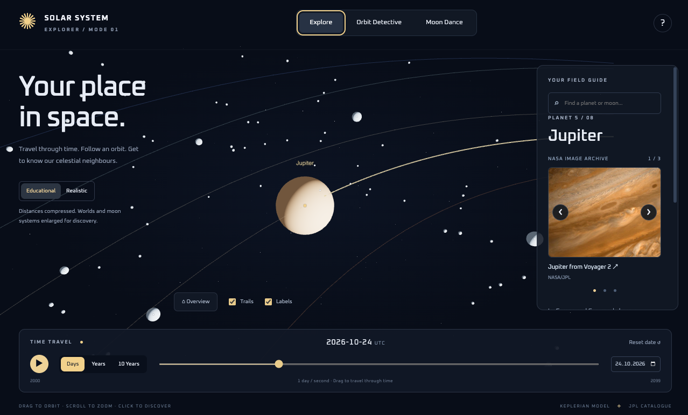
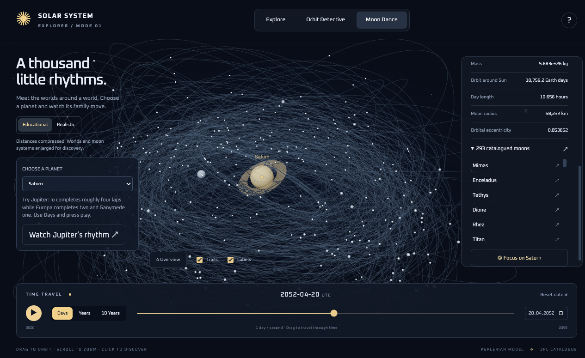

# Solar System Explorer

Get to know our celestial neighbours through an interactive 3D solar system. Explore the Sun, all eight planets, and hundreds of moons. Watch their paths, travel through time, and discover the worlds around each planet.

**[Open the web version →](https://solar-system-beryl-pi.vercel.app/)**  
Built by **[artmelo](https://github.com/artmelo)**.

## Explore a world

Click a planet’s dot or search for a planet or moon to bring up its field guide. Discover its mass, radius, day length, and orbital period, then browse real NASA images with captions and links to the originals.

Drag to look around, zoom in for a closer view, and use **Overview** to return to the wider solar system. Toggle **Labels** and **Trails** to see names and recent orbital paths.



*Get closer to Jupiter, browse its NASA photo gallery, and follow its path around the Sun.*

## Watch the moons dance

Open **Moon Dance** and choose a planet. The planet stays at the centre while its moons move around it. Select a moon to read its details without losing your view of the whole system.

Try **Watch Jupiter’s rhythm** to start playback: Io completes roughly four orbits while Europa completes two and Ganymede completes one. Or choose Saturn to explore its busy family of moons.



*Saturn’s moons trace many different paths around their shared planetary centre.*

## Travel through time

Press **Play** to start, or pause whenever something catches your eye. Choose how quickly time passes:

| Speed | What happens in one real second |
| --- | --- |
| **Days** | One Earth day passes |
| **Years** | One Earth year passes |
| **10 Years** | Ten Earth years pass |

Drag the timeline or enter a date to explore **2000–2099**. **Reset date** returns to the starting date.

## Become an Orbit Detective

Which planet has the most stretched orbit? Open **Orbit Detective**, compare the eccentricity values in the field guide, and choose your answer. You’ll get a clue or an explanation to help you learn.

## Choose your sense of scale

- **Educational:** enlarged worlds and compressed distances make planets and moons easier to explore.
- **Realistic:** planet sizes and orbital distances share one scale. Tiny worlds keep visible dots so you can still find them.

## Use it on your phone or tablet

The app adapts to smaller screens, with larger touch controls and a dedicated space view.

| Action | Computer | Phone or tablet |
| --- | --- | --- |
| Look around | Drag the scene | Drag with one finger |
| Zoom | Scroll | Pinch with two fingers |
| Select a world | Click its dot or search | Tap its dot or search |
| Read details | Use the sidebar | Tap **Details** below the scene |
| Return to the scene | Click **Focus** or **Overview** | Tap **Back to space** |

Use a browser with WebGL support for the 3D view. NASA photographs load over the internet.

## A little about the science

Planet and moon motion follows approximate Keplerian orbits using NASA/JPL data. This is an educational simulation with simplified display scales. Some moons have incomplete records; their catalogue entries remain available even when an orbit or measurement is missing.

- Orbital and physical data: [NASA/JPL Solar System Dynamics](https://ssd.jpl.nasa.gov/sats/)
- Photographs: [NASA Image and Video Library](https://images.nasa.gov/), with individual credits and source links inside the app
- Code: [MIT License](LICENSE)

<details>
<summary>Run the app on your own computer</summary>

With Node.js 22 or 24 installed, download or clone this repository, open its folder in a terminal, and run:

```sh
npm ci
npm run dev
```

Open the local address shown in your terminal.

</details>
